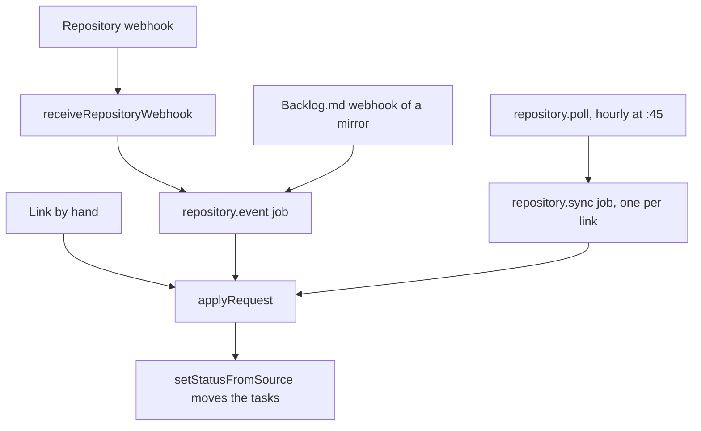

# Architecture

This page is for contributors. Read it to find where a change belongs and why the code is laid out the way
it is.

Zamu is a TypeScript monorepo with three apps and six shared packages. Postgres holds all state: the data,
the sessions and the job queue.

## Terms

Five terms come up all over this page.
- An **actor** is who a request acts as: the user, its kind (person or agent), the workspace and the role
  there, the key scope, and the person an agent acts for.
- The **contract** is the set of Zod schemas and oRPC routes in `packages/contracts`. The server, the web app
  and the CLI all build on it.
- A task's **work record** is what a person or an agent writes while working on it: acceptance criteria,
  done items, a plan, work notes and a final summary.
- A **mirror** is a project that reads its tasks from the Backlog.md files in a repository. Zamu refuses
  writes to the fields those files own.
- A **request** is a pull request or a merge request.

## Components

```text
            browser                         zamu CLI (agents, people)
               |  oRPC RPC + session cookie     |  REST + Bearer zamu_live_ key
               v                                v
   +-----------------------------------------------------------+
   | apps/web  (TanStack Start on Nitro, one Node process)     |
   |   pages + SSR | /api/v1 | /api/auth | /api/webhooks       |
   +-----------------------------------------------------------+
               |                 calls                |  enqueues jobs
               v                                      v
   packages/core  ------------------------------->  Postgres  <---  apps/worker
   (business rules)    Drizzle, one transaction     (data, sessions,   (pg-boss jobs,
                                                     pg-boss queue)     calls core)
```

### Apps

`apps/web` is the only HTTP server. It renders the pages with server-side rendering and serves five groups
of routes:

| Route                           | What it serves                                                                 |
| ------------------------------- | ------------------------------------------------------------------------------ |
| `/api/v1`                       | The oRPC contract, as REST with an OpenAPI document and as oRPC's RPC protocol |
| `/api/auth`                     | Better Auth                                                                    |
| `/api/webhooks/backlog/{id}`    | Push notifications from git hosts                                              |
| `/api/webhooks/repository/{id}` | Pull and merge request events                                                  |
| `/api/healthz`                  | The health check                                                               |

Every page lives under `/w/$workspace/`, where `$workspace` is the workspace's slug. Settings screens also
call TanStack Start server functions.

`apps/worker` runs pg-boss, the job queue. It creates the queues, registers one handler per job name,
schedules the recurring jobs and stops cleanly on SIGTERM. It runs TypeScript through `tsx`, with no build
step.

`apps/cli` is the `zamu` command.
- It talks to `/api/v1` over plain REST with an API key, prints tables or `--json`, and exits with stable
  codes.
- tsdown bundles it, so it carries the contract package inside. The guides that `zamu instructions` prints
  ship inside the bundle too.
- It is published to npm as `@reddevs/zamu` and to the Homebrew tap `reddevsdotio/tap`.
  `scripts/npm-package.ts` builds the folder npm gets. The pnpm workspace package `@zamu/cli` itself is
  never published.
- `scripts/homebrew-formula.ts` writes the Homebrew formula from `docker/homebrew/zamu.rb.template`.

### Packages

`packages/contracts` holds the Zod schemas for every entity and input, the oRPC contract, the error codes,
and the `zamu.v1.*` shapes of the CLI's `--json` output. Everything else imports its types from here.

`packages/core` holds the services: workspaces, projects, tasks and their work record, comments and notes,
milestones and their waves and gates, cycles, labels, Home, members, keys, git connections, Backlog.md,
repository links and pull requests, and the archive.
- Each service takes a context (database, clock, time zone, git settings, job queue), the actor and a parsed
  input.
- `authz.ts` decides who may do what, and every service calls it first.
- `criteria.ts` applies the operations on criteria and done items. It also holds the finishing rule: an
  agent can't move a task to In review or Done while an item is open.
- `waves.ts` holds the waves, the gate results and the lock rule (see [Waves and gates](#waves-and-gates)).

`packages/db` holds the Drizzle schema, the SQL migrations that drizzle-kit generates, and a test helper.
The helper creates a throwaway database and applies every migration to it.

`packages/auth` sets up Better Auth with the organization, API key and generic OAuth plugins.
- It resolves each request to an `Actor`.
- It blocks Better Auth's endpoints under `/api/auth` that create, change or delete workspaces and
  memberships. Core does that work, so its rules always apply.

`packages/git-providers` holds read-only clients for GitHub, GitLab and Gitea/Forgejo behind one
`GitProvider` interface. Every call is a `GET`.
- The interface covers repository lookup, file trees, file contents, open pull or merge requests that touch
  a folder, one request by number, and the requests updated since a time.
- The package also has `parseRequestUrl`, webhook signature checks that also parse request events, and a
  host check that refuses private and cloud metadata addresses.

`packages/backlog-md` is a pure parser and writer for a Backlog.md folder, with no I/O. It takes file
contents and returns typed tasks, milestones and errors. `write.ts` turns tasks and milestones back into
file contents.

Packages export their TypeScript source directly (`"exports": "./src/index.ts"`). Only the web app and the
CLI have a build.

### Deployment

One Docker image holds all three apps. `docker/entrypoint.sh` picks a role from the first argument:

| Argument            | What the container does          |
| ------------------- | -------------------------------- |
| `web` (the default) | Runs the web server              |
| `worker`            | Runs the worker                  |
| `migrate`           | Applies the migrations and exits |
| `zamu`              | Runs the CLI                     |

`docker-compose.yml` runs Postgres, then `migrate`, then `web` and `worker`.
[Self-hosting](self-hosting.md) covers configuration.

## Where data lives

### The work record

A task's work record is spread over a few tables, all in `packages/db/src/schema/app.ts`:

| Data                                    | Where                                                                  |
| --------------------------------------- | ---------------------------------------------------------------------- |
| Acceptance criteria and done items      | `task_item` rows, `kind` `criterion` or `done`, numbered by `position` |
| Plan and final summary                  | `task.plan` and `task.final_summary`                                   |
| Work notes                              | `comment` rows with `kind = note`                                      |
| Who wrote the plan or summary, when     | The latest activity row that changed it; no extra columns              |
| Machine and branch of a change          | `activity.machine` and `branch`, `comment.machine` and `branch`        |
| A project's default done items          | `project.default_done_items`, copied into new tasks                    |
| Implementation notes of a mirrored file | The task's Backlog.md block (`backlog_data`), read-only                |

Every change to an item writes an activity row with the item's number and text, so history reads right
after a reorder.

Mirrored tasks get the same rows from their file, with `source = backlog`. Zamu refuses every write to them.

### Pull requests, the archive and check-again days

The schema is in `packages/db/src/schema/pull-requests.ts` and `app.ts`.

| Data                                 | Where                                                                  |
| ------------------------------------ | ---------------------------------------------------------------------- |
| A project's repository link          | `repository_link`: connection, default branch, webhook, check state    |
| Requests Zamu has seen               | `pull_request`, one row per project and number; `Closes:` keys too     |
| Which tasks a request links, and why | `task_pull_request`: `via_branch`, `via_description`, `via_hand`       |
| A link removed by hand               | `task_pull_request.removed_at`, so branch and description skip it      |
| The branch a task was started from   | `task.work_branch`                                                     |
| When a task closed                   | `task.closed_at`, set on entering Done or Canceled                     |
| Archived                             | `task.archived_at`, `archived_by_id` (null for the job and Backlog.md) |
| Merged with open items               | `task.merged_done_at`, cleared when the task leaves Done               |
| Check again                          | `task.check_again_on` and `check_again_reason`, set together           |
| The archive setting                  | `project.archive_after_days`, null for off                             |

### Where waves and gates live

The schema is in `packages/db/src/schema/waves.ts`. `task.wave_id` is in `app.ts`.

| Data                    | Where                                                                      |
| ----------------------- | -------------------------------------------------------------------------- |
| A milestone's plan link | `milestone.plan_url`: a web address or a file path, never the plan itself  |
| Waves                   | `wave`: milestone, `position` (the number, from 1, dense), name, gate text |
| Gate results            | `gate_result`: state, note, actor, person acted for, machine, branch, time |
| A gate's state          | The newest `gate_result` row of the wave; none means open                  |
| The wave a task is in   | `task.wave_id`, null for none; always a wave of the task's milestone       |
| A task's wave changes   | Activity rows with a `wave` change that stores the wave's number and name  |

There is no unique index on `position`, so a reorder rewrites the numbers in one statement.

## How data moves

### Workspaces

A **workspace** is a Better Auth organization. Every row that belongs to one carries its id, directly or
through its project, and every core query filters by `actor.workspaceId`.
- Keys are unique per workspace only. Two workspaces can each have a project `PAY`.
- Old slugs live in `workspace_slug_alias`, so links made before a rename still resolve.
- The workspace a person used last is `user.last_workspace_id`.

A request names its workspace with the `x-zamu-workspace` header (`WORKSPACE_HEADER` in
`packages/contracts`). What the header does depends on the credentials.
- A session acts in the workspace the header names, by its current or an old slug. Without the header it
  uses the workspace used last, then the oldest membership. A signed-in person who is not a member gets 403
  `NOT_A_MEMBER`, not 401.
- An API key acts in the workspace its metadata names. A header that names another one gets 403
  `WORKSPACE_MISMATCH`. The CLI sends its login's slug on every request, so a wrong key fails loudly.

#### The workspace in the web app

In the web app the slug comes from the URL. The layout route `routes/_app/w/$workspace/route.tsx` does the
setup:
- It resolves the slug. An old slug redirects to the current one, and a workspace you are not in sends you
  to `/`.
- It records the workspace as the one used last.
- It puts the workspace's API set in the route context as `context.api`.

An **API set** is a client that sends the header, plus TanStack Query helpers whose keys start with
`['w', slug]`. Because of those keys, a cached list from one workspace never shows in another, and
switching needs no cache reset.

Components get the same set from `useApi()` in `lib/workspace.tsx`. `useWorkspace()` adds the name and
slug.

Server functions take `{ workspace, input }` (`inWorkspace()` in `lib/server-fn.ts`). They resolve their
actor with `runInWorkspace`, which sets the header the same way.

`/` and the paths from before 0.10 (`/p/…`, `/settings/…`) redirect to the same path under the workspace
used last (`lib/landing.ts`).

### A request from the web app

1. A page loader calls the client in `context.api`, or a component calls the one from `useApi()`. Both come
   from `apps/web/src/lib/orpc.ts` and send `x-zamu-workspace` with the page's slug.
2. During server-side rendering, the client calls the oRPC router in the same process with the incoming
   request's headers, so there is no HTTP round trip. In the browser, it posts to `/api/v1/rpc/*` with the
   session cookie.
3. Middleware in `apps/web/src/server/api/base.ts` turns the cookie or API key and the workspace header into
   an `Actor`, or answers 401 or 403 before the input is parsed. The handler also refuses
   cookie-authenticated writes from other origins.
4. The procedure in `router.ts` hands the parsed input and the actor to a core service.
5. The service checks authorization, writes in one Drizzle transaction, and records an activity row for each
   task change in that same transaction.
6. Errors leave as RFC 9457 problem bodies with a `code`, a `requestId` and field `issues`. The browser and
   the CLI decode them back into typed errors.

Task writes can carry `ifUpdatedAt`. When the stored task is newer, the API answers `409 TASK_CHANGED` with
the current task, and the web app rolls back its optimistic update.

### A request from the CLI

The CLI builds the same contract client over `OpenAPILink`, so its requests are plain REST. It sends
`Authorization: Bearer zamu_live_...` against `/api/v1/...`, with `x-zamu-workspace` set to the login's
slug.

From the middleware on, the path matches the web app's. Key scope (all projects or a list, read or read and
write) narrows what the actor may do.

#### Which login a command uses

The CLI stores one login per server and workspace in `$XDG_CONFIG_HOME/zamu/config.json`.
`apps/cli/src/workspace.ts` picks one per command, in this order:
1. `--workspace`.
2. `ZAMU_KEY`.
3. The login cached for the clone's git remote (`$XDG_STATE_HOME/zamu/clones.json`).
4. The login whose workspace links the remote or has the project `.zamu.json` names.
5. The default.

#### Source headers and the offline queue

Every CLI request also carries `x-zamu-machine` and `x-zamu-branch`. `apps/web/src/server/context.ts` reads
them into the request's source, and core stores it on the activity rows, notes and gate results it writes.

When the server doesn't answer within 5 seconds, the CLI keeps some kinds of write to an existing task in a
local queue (`$XDG_STATE_HOME/zamu/queue.json`, under a lock file). It sends them before its next request.

### Background jobs

Core declares the jobs in `packages/core/src/jobs.ts`, and their handlers in `job-handlers.ts`:

| Job                  | Runs                            | What it does                                                  |
| -------------------- | ------------------------------- | ------------------------------------------------------------- |
| `invitations.expire` | daily, 03:00 UTC                | marks expired invitations                                     |
| `cycles.end-due`     | hourly                          | ends overdue cycles in `APP_TIME_ZONE`, moves open tasks on   |
| `backlog.poll`       | hourly                          | queues a refresh for each Backlog.md mirror                   |
| `backlog.refresh`    | on demand                       | reads one mirror and applies the difference                   |
| `repository.event`   | on demand                       | applies one request event a webhook delivered                 |
| `repository.poll`    | hourly at :45                   | queues a `repository.sync` for each project with a repository |
| `repository.sync`    | on demand                       | reads the requests updated since the last check, applies each |
| `tasks.archive-due`  | daily, 02:30 in `APP_TIME_ZONE` | archives closed tasks past their project's days               |

A refresh starts from setup, a push webhook, the hourly poll, Refresh now in the web app, or
`zamu backlog refresh`.

A producer enqueues a job inside the Drizzle transaction of the write that caused it, so the job row exists
only if that write commits.

The web server holds a send-only pg-boss client that starts on its first enqueue. The worker does the
scheduling and the work.

### A Backlog.md mirror

1. A git host posts a push to `/api/webhooks/backlog/{id}`. The route reads the raw body once, and core
   checks the signature with the source's decrypted webhook secret.
2. A push to the default branch queues a `backlog.refresh`. Bursts within 60 seconds collapse into one run.
3. The worker reads the `backlog/` folder at the branch head through `packages/git-providers`, parses it
   with `packages/backlog-md` and applies the difference in one transaction. A Postgres advisory lock on the
   source makes a second worker skip the run.

Fields that come from the files are read-only in Zamu, the work record included. Comments and cycles stay
editable.

A one-time import is the other mode. It reads the files once, and from then on Zamu owns the tasks.

### Pull requests

A request reaches Zamu in three ways, and all three end in one function, `applyRequest` in
`packages/core/src/pull-requests.ts`.



The three ways in:
1. A webhook. A git host posts a request event to `/api/webhooks/repository/{id}`, and the route reads the
   raw body once. `receiveRepositoryWebhook` in `pull-requests.ts` checks the signature with the link's
   decrypted secret, records the delivery on `repository_link`, and enqueues `repository.event` with the
   parsed request. A mirrored project's Backlog.md webhook hands its request events to the same path.
2. The hourly check. Every hour `repository.poll` queues a `repository.sync` per link. `syncRepository` in
   `repository.ts` lists the requests updated since the last check and refreshes the default branch.
3. A link made by hand.

`applyRequest` then does the rest:
1. It stores the request. It drops an event older than the stored `host_updated_at`.
2. It recomputes the links by work branch and by `Closes:` keys.
3. It writes link and unlink history.
4. It moves tasks through `setStatusFromSource` in `tasks.ts`. A request that is opened or ready moves its
   tasks to In review. A request merged into the default branch moves them to Done when the link closes on
   merge.

Nothing moves in these cases:
- An event from before `moves_from`. Zamu sets `moves_from` when the link is made and when its connection
  changes, so the first check only records what exists.
- A mirrored project. Its tasks never move.

A move made by a request is an activity row with no actor, `origin = 'git'`, the request URL in
`origin_ref`, and a `cause` (`{ kind: 'pull_request', provider, number, event, ... }`). The timeline turns
these rows into a `system` actor that names the host. The nightly archive writes rows with no actor, origin
`app` and an archive cause.

The work branch comes from `x-zamu-branch`. A CLI write that sets the status to In progress or In review
records it on the task (`workBranchFor` in `tasks.ts`) and links the open requests Zamu knows for it.

### The archive

`packages/core/src/archive.ts` archives and restores by hand and runs the nightly job.
- An archived task is read-only. Every write path calls `assertTaskWritable`, which refuses with
  `TASK_ARCHIVED`.
- Lists, boards, Home, the dashboard, project counts and pickers filter on `archived_at is null`.
- Milestone, cycle and subtask progress keep counting archived tasks.
- For a mirrored project the Backlog.md refresh sets and clears `archived_at` from the file's folder
  (`archive/tasks/`), and the export writes archived tasks there.

### Waves and gates

`packages/core/src/waves.ts` holds the waves and their gates. The lock rule is computed in one place,
`waveStates`.
- One query reads the waves of a set of milestones with the latest result of each gate.
- For each wave it returns the number, the gate state, whether the wave is current or locked, and the wave
  it waits for. A wave is locked while an earlier wave's gate has not passed.
- The milestone plan, the task and list rows, the milestone summaries and the refusal all read it, for a
  whole list at once. So the page, the CLI and the server never disagree.

The refusal sits in `tasks.ts` next to the finishing rule (`OPEN_ITEMS`).
- An agent starts a task when it moves it from Backlog or Todo to In progress or In review, on update, bulk
  update or create. When the task's wave is locked, the service throws `WaveLocked` (`409 WAVE_LOCKED`).
- People are never refused. The web app warns them with one start guard that every status path calls.
- `setStatusFromSource` (pull requests, Backlog.md refreshes) never checks the lock.
- Passing a gate checks the wave's tasks and throws `GateTasksOpen` (`409 GATE_TASKS_OPEN`).

Putting a task in a wave goes through `applyTaskPatch`. It writes one `task.updated` row and moves the task
to the wave's milestone in the same row. Changing a task's milestone clears its wave, and so does a
Backlog.md refresh that changes it.

Wave writes take row locks in a fixed order:
- Writes that touch tasks lock the task rows first (in id order, as bulk changes do), then the milestone
  row.
- Writes that touch only waves lock the milestone row. That keeps the numbers dense when two reorders race.

### From a mirror to Zamu as the source

A mirror reads from the repository. The other direction starts with the switch. Settings > Backlog.md calls
two server functions:
1. A check, which asks the git host for open pull or merge requests that change the folder.
2. The switch, which stops the mirror (`backlog_source.detached_at` and `detached_by_id`) and makes every
   field editable.

From then on the repository's `backlog/` folder can be a copy of Zamu:
1. `zamu backlog export` reads `GET /api/v1/projects/{project}/backlog/export`.
2. Core builds the answer with the writer in `packages/backlog-md`.
3. The CLI writes the files into the clone it runs in.

The server never writes to the repository.

### Secrets at rest

Zamu encrypts git connection tokens and webhook secrets at rest with AES-256-GCM under
`APP_ENCRYPTION_KEY`. Without that key the app runs with git connections and mirrors switched off.

## Design choices

### One Postgres, no other stateful service

pg-boss keeps the job queue in Postgres, so a self-hosted install needs no Redis. It brings cron schedules
and retries, and it can enqueue inside a Drizzle transaction.

### Drizzle rather than Prisma

Better Auth and pg-boss both work with Drizzle 1.0, and pg-boss can join a Drizzle transaction. When the
project started, Prisma's next major version was a rewrite that Better Auth did not support.

### Business rules only in `packages/core`

The API, the server functions and the worker are thin adapters. The CLI goes through the API. One rule
therefore has one implementation and one set of tests, whichever client triggers it.

### Contract first with oRPC

The Zod contract in `packages/contracts` drives the server handlers, the web client, the CLI client and the
OpenAPI document. oRPC has a documented TanStack Start adapter. Mounting Hono with zod-openapi inside Start
was not documented.

### RPC for the browser, REST for everyone else

The browser uses oRPC's RPC protocol, which keeps the OpenAPI client out of the web bundle. Server rendering
calls the router in process. The CLI and other clients get stable REST routes and an OpenAPI document.

### Settings stay off the public API

Members, invitations, agents, API keys, git connections and Backlog.md setup use TanStack Start server
functions. They call the same core services but are not part of `/api/v1`. Product data (tasks, projects,
planning, Home) is on `/api/v1`, where agents can reach it.

### Agents are users

An agent is a Better Auth user with `kind = agent`, a responsible person and its own keys. Activity records
the actor and the person it acted for. A shared human token would hide which agent did what.

An agent and its keys belong to one workspace. An agent that works for two is added to each.

### The workspace is in the URL

Pages live under `/w/<slug>/` and requests name the workspace in a header, instead of an active workspace
stored on the session. Two tabs can then show two workspaces, a link opens the same workspace for everyone,
and server rendering knows the workspace from the request alone.

### A CLI for agents, not an MCP server

Agents use `zamu` with their own key, `--json` output and stable exit codes. One client kept the first
versions small. An MCP server is deferred, not ruled out.

### Backlog.md is mirrored or exported, never synced

Backlog.md gives each new task the highest ID plus one, with no reservation. Tasks can differ between
branches, and the file format changes often. Two-way sync would inherit those conflicts, so one side owns
the tasks at a time.

A project either follows the default branch read-only, or Zamu owns it (after an import or the switch). In
the second case the folder in the repository is at most a copy that `zamu backlog export` writes and nobody
reads back.

### Read from git hosts, never write

Zamu links and moves tasks from what the host reports, and changes nothing on the host: no comments,
statuses, labels or webhooks. The adapters can only send `GET`, so a token with read scopes is enough and a
bug can't touch a repository. Admins create the webhook themselves.

### The finishing rule binds agents only

The server refuses an agent that moves a task to In review or Done with open items, and tells it which flags
settle them. People get a dialog that lets them move the task anyway. The rule lives in core, so the API,
the CLI and bulk changes apply it the same way.

### The wave lock binds agents only

Like the finishing rule, the server refuses an agent that starts a task in a locked wave, and lets a person
do it after a warning.

Gates are results that people and agents record with a note, not checks Zamu runs. Zamu reads no CI and runs
nothing.

### React Aria Components for the UI kit

The main screen is a keyboard-driven table. React Aria ships tables and grid lists with keyboard navigation,
selection and virtualization. Styling comes from Tailwind v4 with the default theme removed, so screens can
only use the tokens in `apps/web/src/styles/tokens.css`.

### One image, three roles

Self-hosters build or pull one image and run it three ways. Migrations are a separate one-shot role, and
compose starts web and worker only after it exits cleanly, so both start on the current schema.

## Where to look next

- [API](api.md) for routes, authentication and error bodies.
- [Agents](agents.md) for API keys and running `zamu` in an agent's environment.
- [Backlog.md](backlog-md.md) for connections, mirrors, imports, webhooks, the switch and the export.
- [Repositories](repositories.md) for repository links, pull requests and their webhooks.
- [AGENTS.md](../AGENTS.md) for commands and conventions.
